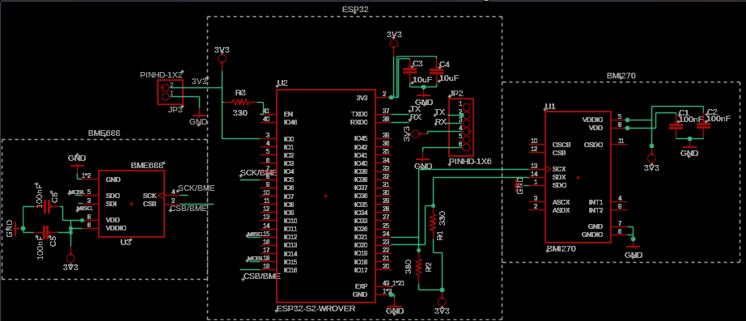
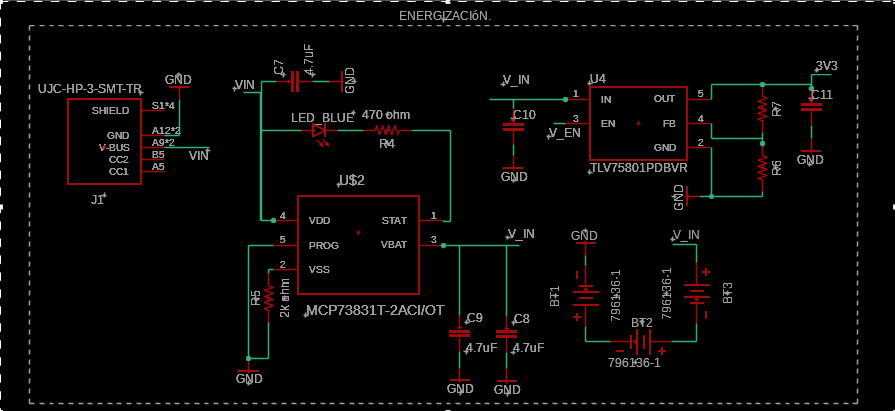
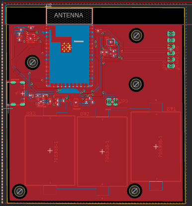
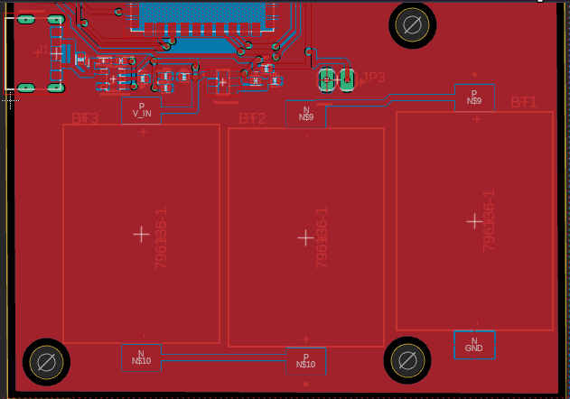
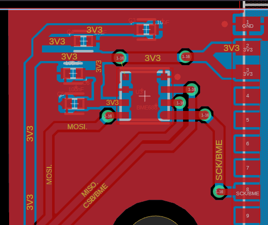
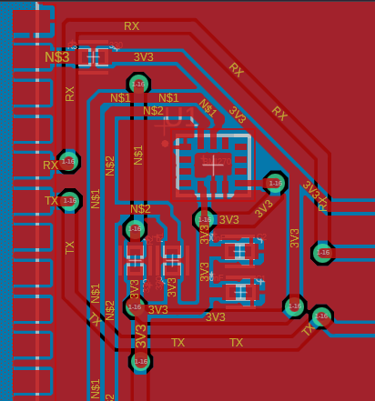

# ESP32 Forest Monitoring System

IoT-based environmental monitoring system designed for early wildfire-risk detection using ESP32, environmental sensors, inertial sensing and long-range communications.

## Overview

This project was developed as part of the Telecommunications Engineering program at the University of Concepción.

The system was designed around distributed ESP32-based sensing nodes capable of collecting environmental and inertial data such as temperature, humidity, air quality and motion.

The project combines embedded systems, sensor integration, PCB design, communication architecture, firmware logic and data-processing concepts.

## Technologies

- ESP32
- BME688 environmental sensor
- BMI270 inertial measurement unit
- LoRa / LoRaWAN
- TCP/IP
- MQTT
- HTTP
- I2C
- SPI
- UART
- Embedded systems
- PCB design
- Environmental sensing
- IoT architecture
- Data acquisition and processing

## System Architecture

The proposed architecture consists of multiple distributed sensing nodes communicating with a central operations system.

The operations center receives information from the sensing nodes and provides a central point for monitoring, configuration and data management.

Each sensing node includes:

- ESP32 microcontroller
- BME688 environmental sensor
- BMI270 inertial sensor
- Battery-powered architecture
- Wireless communication
- Local data acquisition and processing
- Communication with a central monitoring system

## ESP32 Sensor Node Architecture

The sensing node combines power management, processing, environmental sensing, inertial measurements and communication interfaces.

The main hardware blocks include:

- USB-C power input
- Battery charging circuit
- Li-ion / LiPo battery subsystem
- Voltage regulation
- ESP32 processing unit
- BME688 environmental sensor
- BMI270 inertial sensor
- Communication interfaces

## Main Features

- Environmental data acquisition
- Temperature and humidity monitoring
- Air-quality sensing
- Motion and vibration detection
- Wireless communication architecture
- Low-power operating modes
- Configuration storage
- Data transmission to a central system
- Modular and scalable sensor-node design

## Communication Architecture

The project explored multiple communication mechanisms according to the requirements of each section of the system.

### Long-Range Communication

LoRa / LoRaWAN was considered for long-range, low-power communication between sensing nodes and the central system.

### Device–Server Communication

A TCP-based communication flow was designed for initialization, status exchange, configuration and sensor-data transmission.

The communication workflow includes:

- Device handshake
- Status exchange
- Configuration transmission
- ACK/NACK responses
- Sensor-data transmission
- Database interaction

## Firmware Control Flow

The firmware architecture includes system initialization, configuration loading, network connection, TCP socket establishment, handshake processing and multiple operating modes.

The design also considers low-power modes for reducing energy consumption when continuous operation is not required.

## Hardware Design

The project included schematic design and PCB layout development for the ESP32 sensing node.

### Main System Schematic

### Power Supply Schematic

## PCB Design

### Main PCB Layout

The board layout integrates the processing unit, sensor interfaces, antenna section and power-management circuitry.

### Power Section Layout

## Sensor Interfaces

### BME688 Environmental Sensor

The BME688 interface is used for environmental measurements including temperature, humidity and air-quality-related variables.

### BMI270 Inertial Measurement Unit

The BMI270 provides inertial measurements that can be used for motion and vibration monitoring.

## Data Processing

The system architecture considers several stages of sensor-data processing:

- Periodic data acquisition
- Sensor-data filtering
- Threshold evaluation
- Detection of abnormal environmental conditions
- Motion analysis
- Data packaging
- Transmission to the monitoring system

The architecture also allows future integration of machine-learning models for environmental-risk prediction.

## Project Context

Academic engineering project developed as part of the Telecommunications Engineering curriculum at the University of Concepción.

The project focused on the integration of telecommunications, embedded systems, IoT communications, environmental sensing, electronic design and system architecture.

## Author

**Gabriel Gutiérrez Leal**  
Civil Engineer in Telecommunications  
University of Concepción
